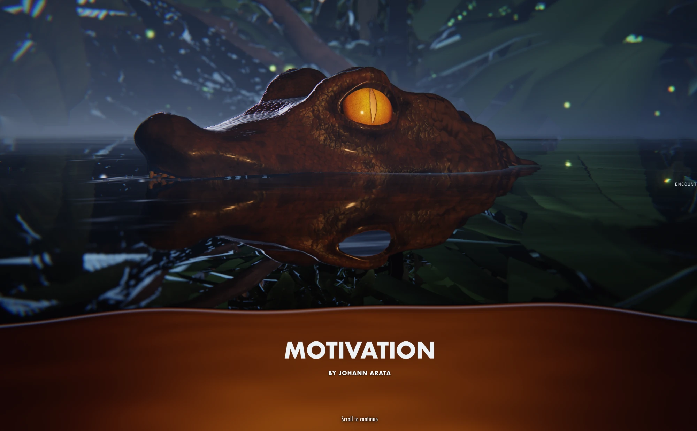

# holosene.fr

Source of [holosene.fr](https://holosene.fr/), the portfolio of Johann Arata, interaction designer and creative technologist.

[](https://holosene.fr/)

**Stack:** hand-written WebGL (no 3D library), Vite, static pre-rendering, FR/EN

## Highlights

- Pages are pre-rendered at build time: content is readable without JavaScript.
- Custom WebGL renderer (`src/gl.js`): dot screen, glass thumbnails, lens effect. Unchanged frames are not redrawn.
- The loader is drawn in a worker so it stays smooth while WebGL warms up.
- Content Security Policy generated at build time, scripts allowed by SHA-256 hash. No trackers.
- Built and deployed to GitHub Pages on every push to `main`, served under holosene.fr by a Cloudflare Worker (`cloudflare/holosene-worker/`), which also proxies each project from its own repository.

## Getting started

```bash
npm install
npm run dev       # http://localhost:5173
npm run build     # dist/
```

---

<details>
<summary><strong>Version française</strong></summary>

# Holosene

Site du studio Holosene (Johann Arata) : captation, reconstruction, 3D temps réel.

- `brand/` — identité : monogramme, logotype, squircle, iridescence, tokens, guide de marque (`brand/guide/index.html`).
- `design/` — recherche : trois directions et la synthèse retenue (D), comparateur (`design/directions/index.html`, touches 1 à 4).
- `src/`, `public/`, `index.html`, `en/` — le site (v0.1, direction D).

## Site

```sh
npm install
npm run dev       # http://localhost:5173 — les mentions « à compléter » sont visibles
npm run build     # dist/ (pages pré-rendues, robots.txt, sitemap.xml)
npm run preview
npm run todo      # liste des textes encore à fournir dans src/content.js
```

- Tout le contenu est dans `src/content.js` (FR/EN). Ce qui manque est marqué `TODO(...)` : invisible en ligne,
  visible avec `?dev` dans l’adresse (`?dev=0` pour revenir) ; `npm run todo` en donne la liste.
- Les pages sont générées à la compilation (`vite.config.js`, gabarit `src/render.js`) : le contenu est lisible sans JavaScript.
- Rendu : WebGL maison, sans bibliothèque 3D (`src/gl.js` : trame de points, vignettes en verre, lentille « o » ;
  `src/backdrop.js` : fond). Une image identique à la précédente n’est pas redessinée.
- Logotypes HOLOSENE et JOHANN ARATA (pack vectoriel exporté de Figma) : `public/logotypes/` (svg, lettres seules,
  png), composant `src/logotype-svg.js` (SVG dans la page, une forme par lettre ou par morceau soudé, couleur = `color`), style
  `src/logotype.css`. Accueil : JOHANN ARATA (une ligne, ou deux sur mobile) ;
  pied de page : JOHANN ARATA au centre (sans animation).
- CV : le bouton « Curriculum vitae » du contact télécharge `public/cv/johann-arata-cv.pdf` (chemin dans `src/content.js`,
  `site.cv`) : y déposer le PDF.
- Chargeur : `src/loader.js` + `src/loader-draw.js`, dessiné dans un worker (`src/loader-worker.js`) pour rester
  fluide pendant la préparation de WebGL. Couleurs et proportions : `design/logo-kit` (voir `CLAUDE.md`).
- Fiches projet : `#p-<slug>`, état piloté par `main.js` (classes `is-open`, `is-closing`…) ; sans JavaScript, `:target`.
  Même mode (clair ou sombre) que l’accueil.
- Langue : redirection vers `/en/` des navigateurs non francophones à la première visite, par le serveur
  (`vercel.json`, en-tête `Accept-Language`) ou à défaut par un script en tête de page ; le choix FR / EN est mémorisé
  (cookie `lang` et `localStorage`).
- Aucun traceur. Stockage local et cookie technique `lang` : la langue choisie (exempté de consentement, voir mentions).
- Sécurité : politique de contenu (CSP) écrite dans chaque page à la compilation (`vite.config.js`, `csp()` : seuls les
  fichiers du site, scripts en ligne autorisés par empreinte SHA-256) ; en-têtes de l'hébergeur dans `vercel.json`
  (cadre interdit, Permissions-Policy, nosniff, COOP ; HTTPS imposé par Vercel). Un script ajouté à la main dans une
  page est bloqué : passer par `src/` ou relancer la compilation.
- Avant la mise en ligne : `npm run todo` liste tout ce qui reste à fournir (textes, PDF du CV, mentions légales).
  Le bouton « Curriculum vitae » n'apparaît en ligne qu'une fois `public/cv/johann-arata-cv.pdf` déposé.

## Publication

Chaque envoi sur `main` compile le site et le publie sur GitHub Pages (`.github/workflows/pages.yml`, holosene.github.io/Portfolio/).
Un Worker Cloudflare (`cloudflare/holosene-worker/`) le sert sous https://holosene.fr/ : la page HOLOSENE à la racine,
le portfolio dans `/portfolio/`, et chaque projet dans `/portfolio/<nom>/`, relayé depuis son propre dépôt.
`.github/workflows/ci.yml` vérifie que le site se compile.

</details>
